I build developer tools and AI automation, mostly in TypeScript and Python.

Zextiria AI is my company. It makes Zextiria Rooms, AgentinFlow and GitNomad. Attentry is separate, and open source.

---

## Projects

###  [Attentry](https://attentry.js.org)

A VS Code extension and Claude Code plugin that checks every edit Claude Code makes.

- After an edit, it tells Claude about the security holes and crash risks that edit added, so Claude fixes them right away
- Before Claude writes a helper, it points to the one the repo already has
- Copied and unused code show up at check-ins, and in a summary at the end
- Runs locally with no AI, so a clean edit costs zero tokens

Works in VS Code, Cursor and Windsurf.

[Site](https://attentry.js.org) · [Repo](https://github.com/Aarv-1o/Attentry) · [Demo](https://github.com/Aarv-1o/attentry-demo) · [Marketplace](https://marketplace.visualstudio.com/items?itemName=attentry.attentry) · [Open VSX](https://open-vsx.org/extension/attentry/attentry)

###  [AgentinFlow](https://www.agentinflow.com)

An AI automation studio. We build what you ask.

- Websites and apps, built to your brief
- Agents that take on the repetitive work a team does by hand
- n8n workflows that move data between the tools you already run
- Saves clients 20+ hours a week, and cuts manual tasks by 90%

[agentinflow.com](https://www.agentinflow.com)

###  [Zextiria Rooms](https://www.zextiriaai.com)

Shared project rooms where an AI drafts and the client approves. The product Zextiria AI is betting on.

- Invite the other side with one link. No account to create, no org to join
- Everyone brings their own agent over MCP — Claude Code, Cursor, Codex, Antigravity
- An agent proposes. Nothing lands in the document until a person signs it
- Every change keeps its record: who asked, whose agent wrote it, who approved

[zextiriaai.com](https://www.zextiriaai.com)

###  [GitNomad](https://marketplace.visualstudio.com/items?itemName=gitnomad.gitnomad-desktop)

A mobile editor for the project on your computer. Edit a file on the bus and it lands on your desktop as a git commit.

- Two-way sync: phone edits become commits, desktop edits show up on the phone
- Start a command from your phone and watch the output stream back
- The git repo on your computer stays the source of truth
- Android app on Google Play, plus a VS Code extension for the desktop side

---

## Tech

TypeScript, JavaScript, Python, Node.js, C#, n8n, and a lot of VS Code extension work.

---

## Elsewhere

[aarv.is-a.dev](https://aarv.is-a.dev/) · [Zextiria AI](https://www.zextiriaai.com) · [AgentinFlow](https://www.agentinflow.com) · [GitNomad](https://marketplace.visualstudio.com/items?itemName=gitnomad.gitnomad-desktop) · [aarvsinghchauhan@gmail.com](mailto:aarvsinghchauhan@gmail.com)
